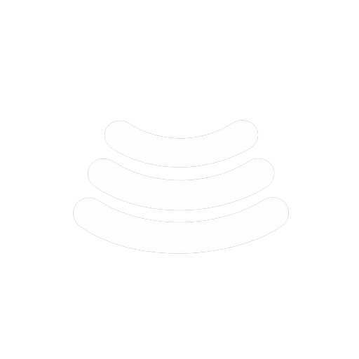

<div align="center">

<br/>



# Mellow

### The Aesthetic Music Experience
**Unified YouTube Music & Spotify Sync · Apple Music Discord Presence · Dynamic Ambient Glow**

<br/>

[](https://github.com/notzeoxalt2/Mellow/releases)
[](LICENSE)
[](https://github.com/notzeoxalt2/Mellow/releases)
[](https://github.com/notzeoxalt2/Mellow/releases)

<br/>

[**Download Installer**](https://github.com/notzeoxalt2/Mellow/releases/latest) · [**Features**](#features) · [**Desktop Quickstart**](#desktop-quickstart) · [**Disclaimer**](#disclaimer)

<br/>

</div>

---

<div align="center">


<h1><a id="features"></a>Features</h1>

<table>
  <tr>
    <td width="50%" valign="top">

#### 🎵 Unified Playback & Smart Dual Sync
- **YouTube Music & Spotify Dual Sync**: Real-time cross-platform sync for Liked Songs and playlists with instantaneous UI updates.
- **Official Music Videos**: Automatically resolves and streams official HD music videos from creators without split-screen or layout glitches.
- **Hi-Res Lossless Audio**: Premium audio streaming with seamless gapless playback and adjustable transitions.
- **Search & Explore**: Unified search covering artists, albums, songs, and community playlists.

#### 🎨 Aesthetic Design & Fluid Motion
- **Fluid WebGL Mesh Glow**: Dynamic multi-color ambient lighting that samples album art with organic fluid mesh shader motion.
- **Apple-Inspired Floating Transport**: Polished frosted-glass controls, volume slider with precise muting, and responsive time scrubbers.
- **Synchronized Lyrics**: Word-by-word karaoke highlights and flowing line animations for any track.
- **Modern Acrylic Header**: Frameless Windows window with native minimize, maximize, and close controls.

    </td>
    <td width="50%" valign="top">

#### 💬 Realistic Apple Music Discord RPC
- **Authentic Apple Music Presence**: Broadcasts playing status to Discord identically to the official Apple Music desktop app.
- **Direct IPC Communication**: Low-latency native pipe integration (`\\.\pipe\discord-ipc-0`) without requiring third-party bot tokens.
- **Rich Track Metadata**: Live artist names, album art, duration timestamps, and play/pause state.

#### ⚡ Performance & Desktop Controls
- **Windows Accent Sync**: Harmonizes UI accents with Windows 11 system colors.
- **Taskbar Thumbbar**: Control previous, play/pause, and next directly from Windows taskbar preview.
- **Silent Background Auto-Updater**: Instant notification and one-click upgrades when a new version is released.
- **Clean Grouped Settings**: Simplified Apple-style settings cards for fast audio and account configuration.

    </td>
  </tr>
</table>

</div>

---

<div align="center">

<h1><a id="download"></a>Download Mellow</h1>

<a href="https://github.com/notzeoxalt2/Mellow/releases/latest">
  
</a>

<br/><br/>

Get the latest installer (`Mellow-Setup-1.1.0.exe`) or portable zip (`Mellow-Setup-1.1.0.zip`) from the [**Releases**](https://github.com/notzeoxalt2/Mellow/releases/latest) page.

</div>

---

## <a id="desktop-quickstart"></a>Development Quickstart

To run Mellow locally or build from source:

```bash
# Clone the repository
git clone https://github.com/notzeoxalt2/Mellow.git
cd Mellow

# Install dependencies
corepack pnpm install

# Start local web development server
corepack pnpm --filter @bitchord/app dev

# Build web frontend and desktop bundle
corepack pnpm --filter @bitchord/app build
node web/desktop/build.js
node web/desktop/package.js

# Build NSIS Installer and Portable ZIP
cd web
npx electron-builder --prepackaged release/Mellow-win32-x64 --config desktop/electron-builder.json
```

---

<div align="center">

<h1><a id="disclaimer"></a>Disclaimer & Legal Notice</h1>

Mellow is an independent, community-driven third-party audio player and client. It is **not** associated with or endorsed by Google LLC, YouTube Music, Spotify AB, Apple Inc., or any of their parent companies.

* **No Media Hosting:** Mellow does not host, upload, or store copyrighted music files. It operates strictly as an interface to scan local device storage or stream media directly from public, public-facing, or user-authenticated APIs.
* **Fair Use & API Usage:** This software is created solely for personal research, educational, and fair-use purposes. The user is entirely responsible for ensuring their usage aligns with their local copyright laws and third-party Terms of Service.

</div>

---

<div align="center">

<h1>License</h1>

This project is licensed under the **GNU General Public License v3.0 (GPLv3)**. See the [LICENSE](LICENSE) file for details.

</div>
